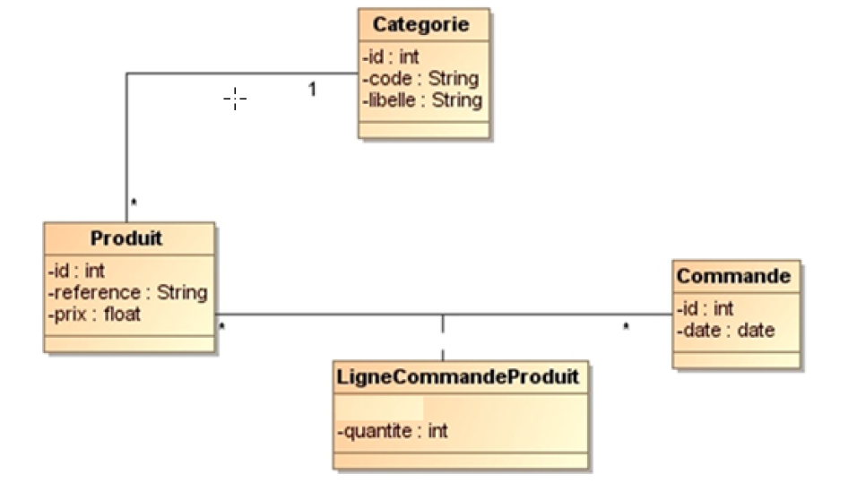
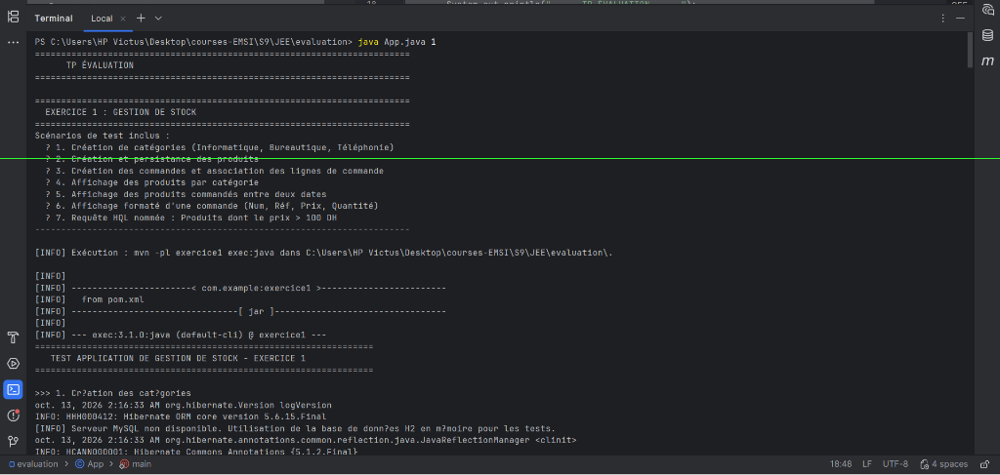
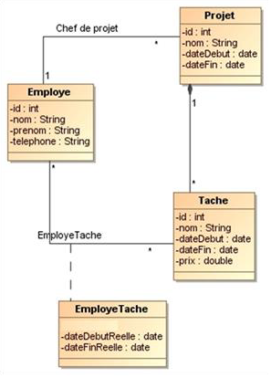
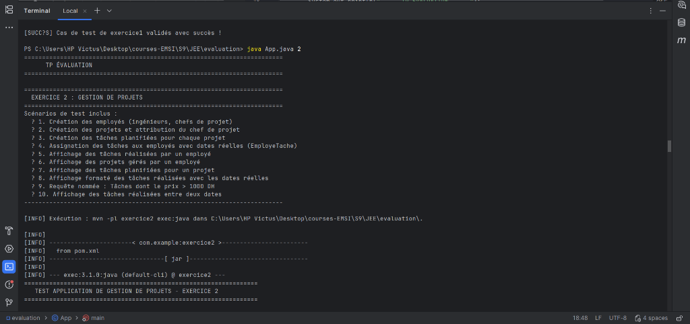
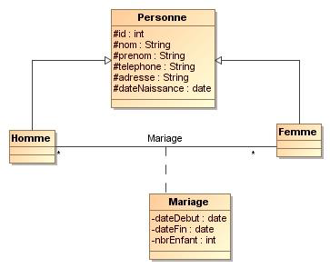
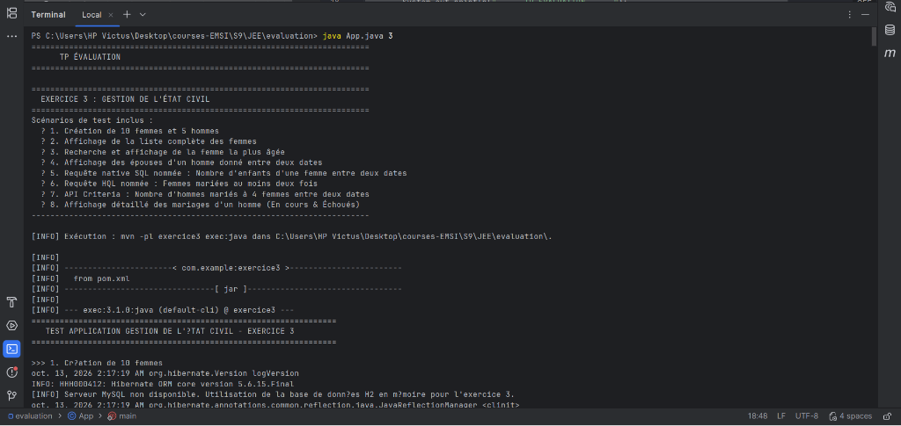

# TP Évaluation

Ce projet regroupe les **3 exercices** d'évaluation en JEE portant sur la mise en œuvre de la persistance objet-relationnelle avec **JPA / Hibernate**, le découpage en couches (Beans/Entités, DAO générique, Services métier) et l'utilisation de requêtes avancées (HQL, Requêtes nommées, Requêtes natives SQL et API Criteria).

---

## Sommaire

1. [Structure globale du projet](#structure-globale-du-projet)
2. [Instructions d'exécution](#instructions-dexécution)
3. [Exercice 1 — Application de Gestion de Stock](#exercice-1--application-de-gestion-de-stock)
4. [Exercice 2 — Application de Gestion de Projets](#exercice-2--application-de-gestion-de-projets)
5. [Exercice 3 — Application de Gestion de l'État Civil](#exercice-3--application-de-gestion-de-létat-civil)
6. [Technologies et Dépendances](#technologies-et-dépendances)

---

## Structure globale du projet

Le projet est organisé sous la forme d'un projet multi-modules Maven garantissant l'indépendance de chaque exercice dans son propre répertoire :

```
evaluation/
├── pom.xml                                 # POM parent multi-modules
├── App.java                                # Exécuteur global (java App.java [1|2|3|all])
├── screenshots/                            # Captures d'écran d'exécution & diagrammes UML
│   ├── exercice1_execution.png
│   ├── exercice1_uml.png
│   ├── exercice2_execution.png
│   ├── exercice2_uml.png
│   ├── exercice3_execution.png
│   └── exercice3_uml.png
├── src/main/java/com/example/
│   ├── App.java                            # Classe principale globale
│   └── Main.java                           # Redirection vers App
│
├── exercice1/                              # EXERCICE 1 : Gestion de Stock
│   ├── pom.xml
│   └── src/main/java/ma/projet/
│       ├── classes/                        # Categorie, Produit, Commande, LigneCommandeProduit
│       ├── dao/                            # IDao<T>
│       ├── service/                        # ProduitService, CategorieService, CommandeService, ...
│       ├── util/                           # HibernateUtil
│       └── test/                           # Test.java, App.java
│
├── exercice2/                              # EXERCICE 2 : Gestion de Projets
│   ├── pom.xml
│   └── src/main/java/ma/projet/
│       ├── classes/                        # Employe, Projet, Tache, EmployeTache
│       ├── dao/                            # IDao<T>
│       ├── service/                        # ProjetService, TacheService, EmployeService, ...
│       ├── util/                           # HibernateUtil
│       └── test/                           # Test.java, App.java
│
└── exercice3/                              # EXERCICE 3 : Gestion de l'État Civil
    ├── pom.xml
    └── src/main/java/ma/projet/
        ├── beans/                          # Personne (Abstraite), Homme, Femme, Mariage
        ├── dao/                            # IDao<T>
        ├── service/                        # HommeService, FemmeService, MariageService
        ├── util/                           # HibernateUtil
        └── test/                           # Test.java, App.java
```

---

## Instructions d'exécution

### 1. Lancer les tests directement en ligne de commande

À la racine du projet (`evaluation/`), exécutez simplement :

```powershell
# Exécuter les 3 exercices à la suite :
java App.java all

# Exécuter un exercice spécifique :
java App.java 1    # Exercice 1 (Stock)
java App.java 2    # Exercice 2 (Projets)
java App.java 3    # Exercice 3 (État Civil)
```

### 2. Lancer via Maven

```powershell
# Compiler et exécuter tous les tests unitaires :
mvn clean test

# Exécuter le programme de test d'un sous-module :
mvn -pl exercice1 exec:java
mvn -pl exercice2 exec:java
mvn -pl exercice3 exec:java
```

### 3. Lancer depuis IntelliJ IDEA / Eclipse / VS Code
* Ouvrez le fichier `App.java` (ou `src/main/java/com/example/Main.java`).
* Cliquez sur **Run (Bouton ▶ vert)** ou faites **Ctrl + Shift + F10**.

---

## Exercice 1 — Application de Gestion de Stock

### Contexte & Objectif
Gestion du catalogue de produits informatiques, de leurs catégories et des commandes clients passées avec le détail des lignes de commande (prix unitaire, quantité).

### Diagramme de classes


### Fonctionnalités & Requêtes développées
* **Entités (`ma.projet.classes`)** : `Categorie`, `Produit`, `Commande`, `LigneCommandeProduit` (avec clé composite `LigneCommandeProduitPK`).
* **Requêtes spécifiques** :
  * `afficherProduitsParCategorie(Categorie c)` : Affichage de tous les produits d'une catégorie.
  * `afficherProduitsCommandesEntreDates(Date d1, Date d2)` : Liste des produits commandés sur un intervalle de temps.
  * `afficherProduitsParCommande(Commande cmd)` : Affichage formaté d'une commande selon le modèle :
    ```
    Commande : 4     Date : 14 Mars 2013
    Liste des produits :
    Num  Réf     Prix    Quantité
    1    ES12    120 DH  3
    2    ZR85    100 DH  14
    3    EE85    200 DH  5
    ```
  * `findByPrixGreaterThan` : Requête HQL nommée pour les produits dont le prix dépasse 100 DH.

### Capture d'exécution


---

## Exercice 2 — Application de Gestion de Projets

### Contexte & Objectif
Suivi du temps passé sur les projets d'un bureau d'études, planification des tâches et calcul des coûts globaux avec dates réelles de réalisation.

### Diagramme de classes


### Fonctionnalités & Requêtes développées
* **Entités (`ma.projet.classes`)** : `Employe`, `Projet` (avec chef de projet), `Tache`, `EmployeTache` (association avec dates réelles et clé composite `EmployeTachePK`).
* **Requêtes spécifiques** :
  * `EmployeService.afficherTachesParEmploye(Employe e)` : Tâches réalisées par un employé.
  * `EmployeService.afficherProjetsGeresParEmploye(Employe e)` : Projets supervisés en tant que chef de projet.
  * `ProjetService.afficherTachesPlanifiees(Projet p)` : Liste des tâches prévues sur un projet.
  * `ProjetService.afficherTachesRealisees(Projet p)` : Affichage formaté des tâches réalisées avec les dates réelles :
    ```
    Projet : 4      Nom : Gestion de stock     Date début : 14 Janvier 2013
    Liste des tâches:
    Num  Nom                             Date Début Réelle   Date Fin Réelle
    1    Analyse et conception           14/01/2013          28/01/2013
    2    Développement de la couche DAO  29/01/2013          10/02/2013
    3    Développement couche Service    11/02/2013          25/02/2013
    ```
  * `findTachesPrixSuperieurA1000` : Requête nommée des tâches dont le coût > 1000 DH.
  * `afficherTachesEntreDates(Date d1, Date d2)` : Tâches réalisées sur un intervalle temporel donné.

### Capture d'exécution


---

## Exercice 3 — Application de Gestion de l'État Civil

### Contexte & Objectif
Gestion des citoyens d'une province et de leurs relations matrimoniales (mariages en cours, mariages passés/échoués, nombre d'enfants).

### Diagramme de classes


### Fonctionnalités & Requêtes développées
* **Entités (`ma.projet.beans`)** :
  * `Personne` : Classe abstraite avec stratégie d'héritage `@Inheritance(strategy = InheritanceType.JOINED)`.
  * `Homme` et `Femme` : Héritent de `Personne`.
  * `Mariage` : Relation avec `dateDebut`, `dateFin` (`null` si en cours), `nbrEnfant`.
* **Requêtes spécifiques** :
  * `HommeService.afficherEpousesEntreDates(Homme h, Date d1, Date d2)` : Épouses d'un homme entre deux dates.
  * `FemmeService.getNombreEnfantsEntreDates(Femme f, Date d1, Date d2)` : **Requête native SQL nommée** (`countEnfantsEntreDates`).
  * `FemmeService.getFemmesMarieesAuMoinsDeuxFois()` : **Requête HQL nommée** (`findFemmesMarieesAuMoinsDeuxFois`).
  * `FemmeService.findFemmePlusAgee()` : Recherche de la femme la plus âgée.
  * `HommeService.countHommesMariesQuatreFemmesEntreDates(Date d1, Date d2)` : Utilisation de **l'API Criteria de JPA** (`CriteriaBuilder`, `CriteriaQuery`, `having(countDistinct >= 4)`).
  * `HommeService.afficherMariagesHomme(Homme h)` : Formatage complet avec distinction des mariages :
    ```
    Nom : SAFI SAID
    Mariages En Cours :
    1. Femme : SALIMA RAMI   Date Début : 03/09/1990    Nbr Enfants : 4
    2. Femme : AMAL ALI      Date Début : 03/09/1995    Nbr Enfants : 2
    3. Femme : WAFA ALAOUI   Date Début : 04/11/2000    Nbr Enfants : 3

    Mariages échoués :
    1. Femme : KARIMA ALAMI  Date Début : 03/09/1989    
    Date Fin : 03/09/1990    Nbr Enfants : 0
    ```

### Capture d'exécution


---

## Technologies et Dépendances

* **Langage** : Java 21 / 17
* **Framework ORM** : Hibernate Core `5.6.15.Final`
* **Spécification de persistance** : JPA 2.2 (`javax.persistence-api`)
* **Bases de données** :
  * **MySQL 8.0** (`mysql-connector-j 8.0.33`) configuré dans `application.properties`.
  * **H2 Database** (`h2 2.2.224`) configuré en fallback mémoire automatique dans `HibernateUtil` garantissant l'exécution immédiate même si le serveur MySQL local est éteint.
* **Build & Gestion des dépendances** : Apache Maven (Multi-modules Reactor).
* **Tests unitaires** : JUnit 4.13.2.
